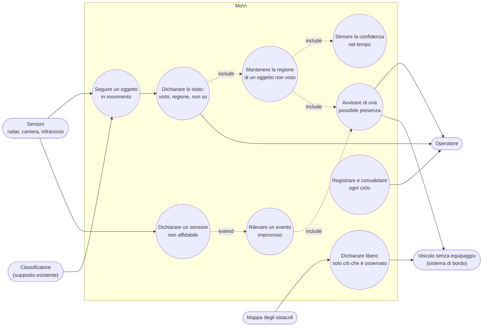
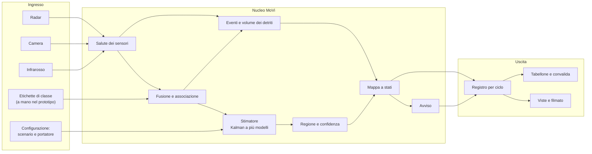
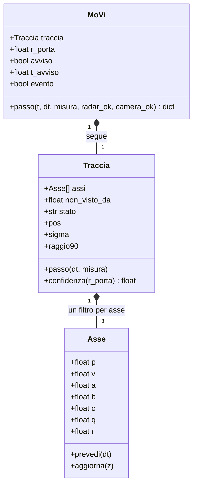
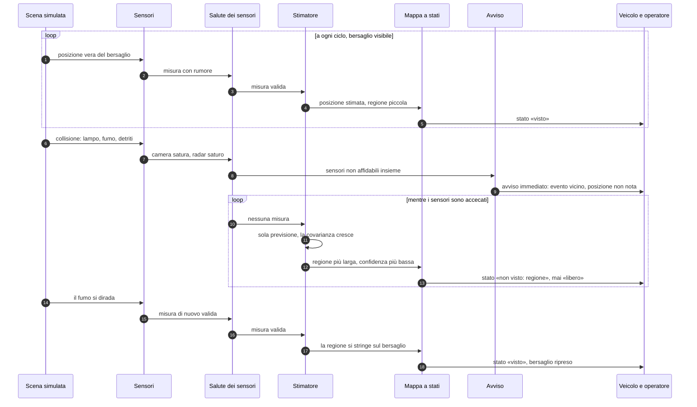
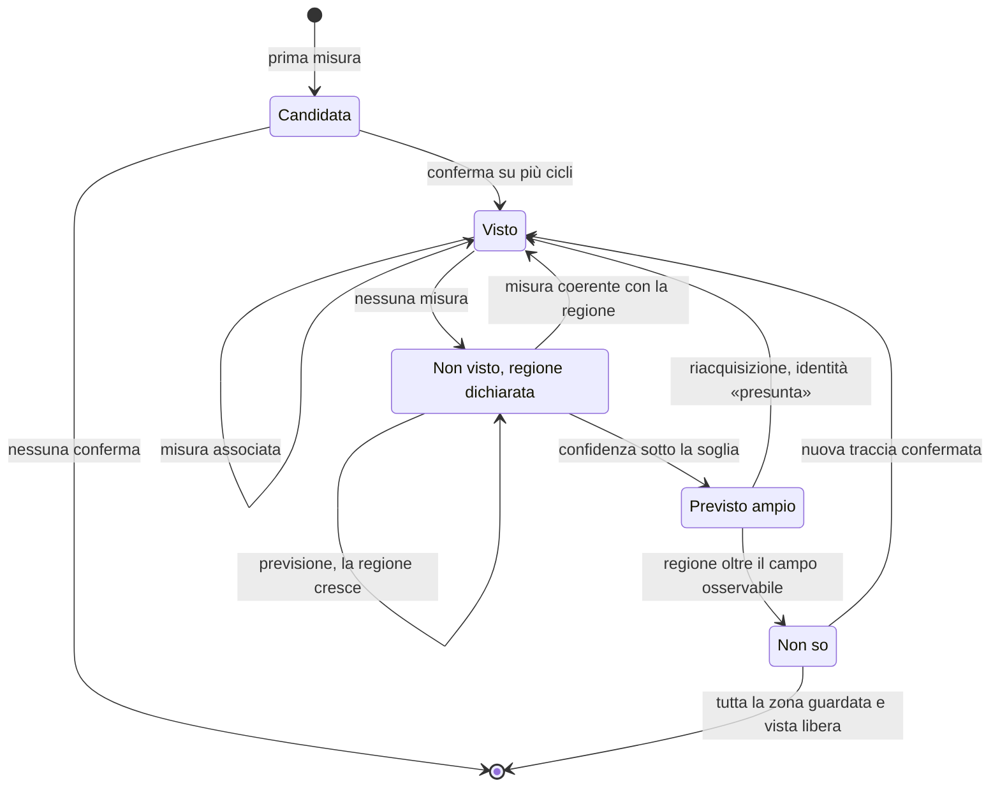
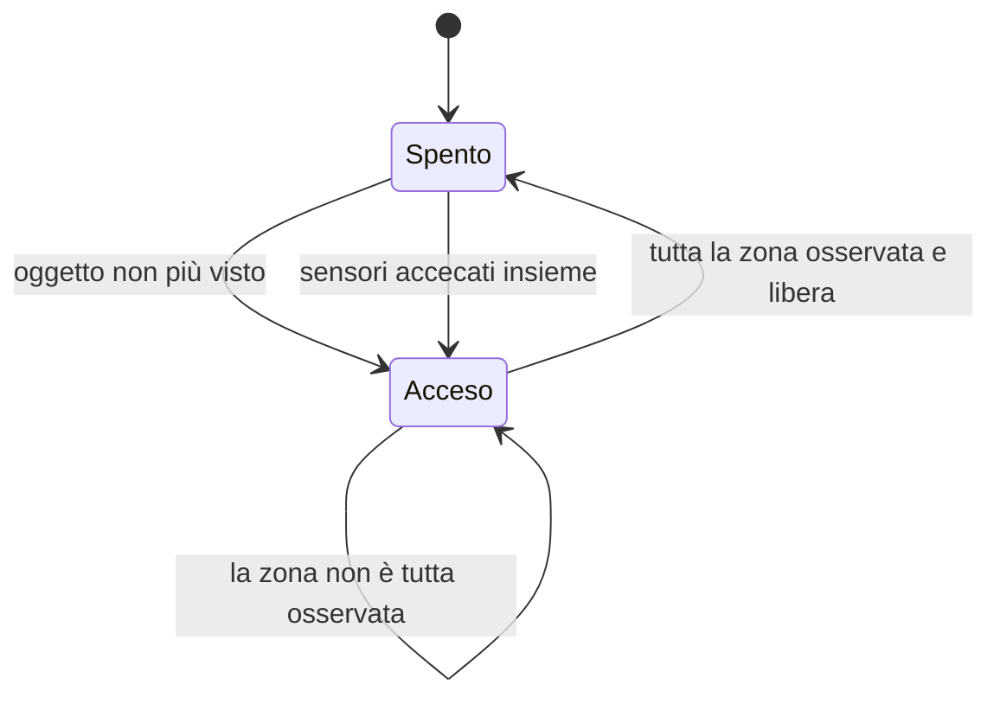
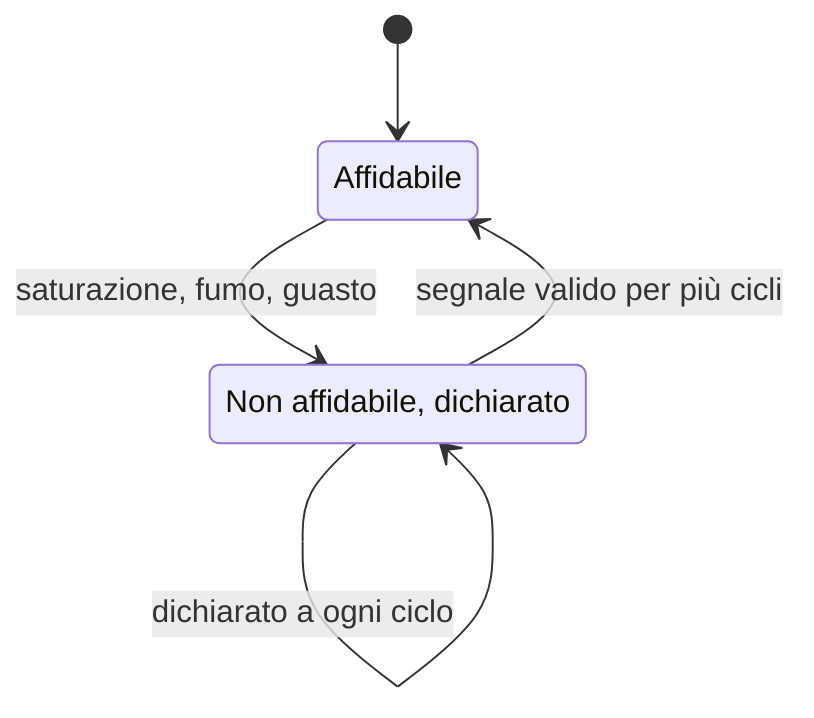
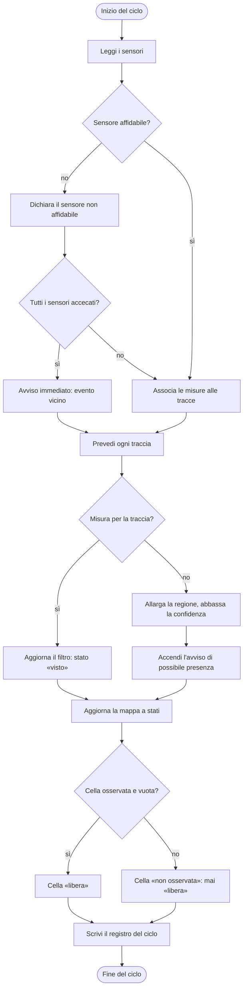

# MoVi — diagrammi UML

I diagrammi sono scritti in Mermaid: GitHub li disegna da solo aprendo questo file. Descrivono il prototipo
simulato (`prototipo/`) e la dimostrazione 3D (`prototipo/unreal/`). MoVi osserva e avvisa: nessuna uscita è un
comando al veicolo.

## 1. Casi d'uso

Mermaid non ha un tipo «casi d'uso»: il diagramma usa gli attori ai lati e i casi d'uso come ovali.

## 2. Componenti

## 3. Classi del nucleo

Le classi sono quelle di `prototipo/unreal/movi_core.py`, il porto compatto del nucleo usato nella dimostrazione 3D.

`Asse` è un filtro di Kalman a velocità costante su un asse, con covarianza `[[a, b], [b, c]]`.
`Traccia.raggio90` è il raggio della regione al 90 %: 2,146 volte `sigma`.
`Traccia.confidenza` è C = 1 − exp(−r² / 2σ²).

## 4. Sequenza: collisione vicina con sensori accecati

Scenario della scorta: il drone che porta MoVi segue un bersaglio veloce; accanto, due droni collidono.

## 5. Stati di una traccia

## 6. Stati dell'avviso di possibile presenza

L'avviso non si spegne per tempo, identità o operatore: si spegne solo guardando tutta la zona.

## 7. Stati di un sensore

## 8. Attività: un ciclo di percezione

